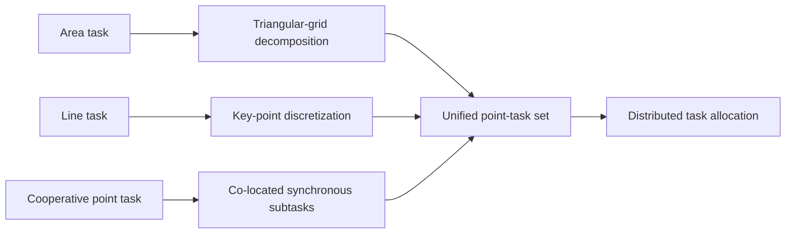
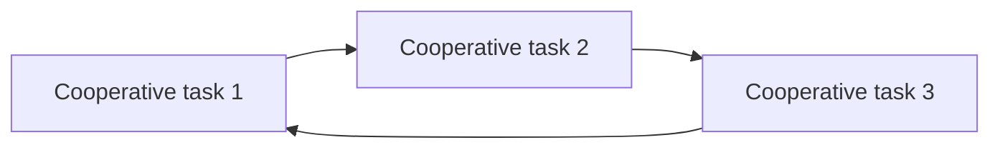

# Distributed Task Planning for Synchronous Heterogeneous Tasks

## Literature Review for General Interaction-Aware Goal Assignment

**Paper:** Liang Lu, Xiangquan Gao, Hao Wang, Ming Xiang, Zhiyang Zhang, and Bin Han, *Distributed Task Planning Method for Synchronous Execution of Heterogeneous Tasks in Uncertain Environments*, IEEE Transactions on Automation Science and Engineering, Vol. 23, 2026.  
**DOI:** [10.1109/TASE.2026.3670128](https://doi.org/10.1109/TASE.2026.3670128)

---

## Why this paper matters for our research

Our research direction is **General Interaction-Aware Goal Assignment for Multi-Robot Systems**. The main question is not simply how to minimize a pairwise robot-goal cost such as distance. We want assignment quality to reflect the **collective consequences of the assignment during later planning and execution**, including conflicts, congestion, blocking, synchronization, and other robot-robot interactions.

This paper is not a direct one-shot goal-assignment method. It studies a broader task-planning problem with heterogeneous tasks, uncertainty, cooperative synchronization, distributed allocation, and collision-free execution. However, it is highly relevant because it provides a concrete example where assignment quality depends on **other robots and their task sequences**, rather than only on independent robot-task costs.

> **Main takeaway:** The paper moves beyond purely independent robot-task scoring by adding synchronization-aware cooperative gains and graph-based dependency reasoning. However, its interaction model is specialized to cooperative task synchronization and deadlock prevention rather than general motion interaction.

---

# 1. What exactly is the paper solving?

The paper considers a robot swarm operating in an uncertain environment with three geometrically different task types:

- **Area tasks** — coverage or monitoring of a region.
- **Line tasks** — inspection along a path.
- **Point tasks** — ordinary independent tasks or cooperative tasks requiring several robots to execute synchronously.

For a cooperative point task, participating robots must arrive within a prescribed synchronization tolerance.

The overall problem is therefore not simply

```text
robots + goals -> one-to-one assignment
```

but closer to

```text
robots + heterogeneous tasks + task dependencies + uncertainty
        ↓
unified task representation
        ↓
distributed task allocation and sequencing
        ↓
synchronized collision-free execution
```

The framework has four important components:

1. **CVaR-based task execution-time estimation** under environmental uncertainty.
2. **Unified task representation**, converting area, line, and cooperative tasks into equivalent point-task sets.
3. **Distributed task allocation with deadlock prevention**, using a Cooperative Task Directed Graph (CTDG), auction, consensus, and cycle detection.
4. **Progress-aware cooperative motion planning**, combining synchronization-aware desired velocity with ORCA collision avoidance.

### Paper figure: heterogeneous-task transformation

The paper's **Fig. 2 (paper page 6207)** shows how area, line, and point tasks are converted into a common point-task representation. The simplified schematic below recreates the structure of that figure for this review.



**Why this matters:** the assignment algorithm receives a standardized point-task representation even though the original tasks have different geometries.

This means the paper is solving a broader **MRTA + scheduling + motion-planning** problem rather than the initial one-shot goal-assignment problem in our project.

---

# 2. What representation of assignment quality does it use?

The paper does **not** represent assignment quality only by a pairwise cost such as

```math
c_{ij}=d(r_i,g_j).
```

Instead, each robot is assigned an **ordered task sequence** and receives a performance value.

```math
f_{R_i}(S_{R_i})
=
\sum_{T_j\in S_{R_i}}
\mu_{ij}\omega_j
\lambda_d^{L(p_i^j)}
\lambda_n^{\delta(p_i^j)}.
```

The terms encode:

| Term | Meaning |
|---|---|
| $\mu_{ij}$ | robot-task fitness / capability |
| $\omega_j$ | task urgency |
| $L(p_i^j)$ | estimated travel/arrival time using the CVaR model |
| $\delta(p_i^j)$ | number of tasks associated with the path/sequence |
| $\lambda_d$ | travel-time discount factor |
| $\lambda_n$ | task-number / workload discount factor |

The global objective is

```math
S^*
=
\arg\max_{S\in S_{\mathrm{feasible}}}
\sum_{R_i\in R} f_{R_i}(S_{R_i}).
```

So the base score already depends on more than geometric distance: it also includes **robot capability, urgency, estimated execution time, and load**.

## Marginal gain during auction

The distributed auction evaluates the marginal gain of adding a candidate task:

```math
\Delta f(v\mid S)
=
f(S\cup\{v\})-f(S).
```

For cooperative tasks, the paper adds a **cooperative performance gain**:

```math
\Delta f^s_{R_i}(T_j\mid T_{R_i})
=
\Delta f_{R_i}(T_j\mid T_{R_i})
+
h_{R_i}(T_j\mid T_{R_i}).
```

The additional term depends on the cooperative context. It accounts for whether the candidate robot fits the synchronization requirement with other robots, and a candidate assignment is rejected if it would create a cycle in the cooperative task-dependency graph.

### Interpretation

The most useful way to summarize the paper's assignment representation is:

> **Assignment quality = individual task-sequence utility + cooperative-context correction.**

This is an important step beyond ordinary pairwise robot-goal costs.

However, the representation is still **manually designed and problem-specific**. Its interaction correction is built mainly around synchronous cooperative tasks and dependency/deadlock structure, not around general collective motion effects such as congestion or path crossing.

---

# 3. Does it account for robot-robot interaction?

## Yes, but only partially.

This distinction is important for our project.

## 3.1 Interaction during task allocation: yes

The paper introduces the **Cooperative Task Directed Graph (CTDG)**. A directed edge between two cooperative task groups means that the task order of one or more robots creates a dependency between those groups.

For example:

```math
T_{s1}\rightarrow T_{s2}.
```

Across several robots, inconsistent task orders can create a dependency cycle:

```math
T_{s1}\rightarrow T_{s2}\rightarrow T_{s3}\rightarrow T_{s1}.
```

A cycle means circular waiting and therefore a potential deadlock.

During bidding, each robot checks whether a candidate task would introduce such a cycle. Therefore, the feasibility and value of assigning a task to one robot depend on assignments involving other robots.

That is genuinely **interaction-aware assignment**.

### Paper figure: assignment-induced cooperative deadlock

The paper's **Fig. 4 (paper page 6208)** illustrates how several individually reasonable task sequences can collectively generate a circular dependency. The simplified schematic below recreates the key idea.



The important point is not just collision avoidance: **the assignment/task-order decision itself can create an impossible global dependency structure**. CTDG detects this before execution.

## 3.2 Interaction through synchronization: yes

For a cooperative task, one robot's timing cannot be evaluated independently. The paper aligns the participating robots according to their relevant ready/arrival times.

Therefore, one robot's schedule depends on the schedules of the other robots participating in the same cooperative task.

In other words, the value of assigning robot $R_i$ to task $T_j$ is not always a function of $R_i$ and $T_j$ alone.

## 3.3 Robot-robot collision interaction: yes, but mainly after assignment

During execution, the system uses ORCA to avoid robot-robot and robot-obstacle collisions. The preferred velocity is also adjusted according to cooperative task progress so that robots can arrive synchronously.

However, this reveals the main limitation relative to our project:

> **General motion interactions are mostly handled by the execution layer after an assignment has already been selected.**

The assignment score does not directly predict whether a candidate assignment will create many path crossings, narrow-passage competition, congestion, or ORCA-induced waiting.

### Interaction coverage

| Interaction | Included in assignment? |
|---|---:|
| Robot-task distance / time | Yes |
| Robot capability | Yes |
| Robot workload | Yes |
| Cooperative arrival timing | Yes |
| Cross-robot task dependency | Yes |
| Circular deadlock | Yes |
| Robot-robot collision avoidance | Mostly execution layer |
| Path crossing caused by assignment | No |
| Congestion caused by assignment | No |
| Narrow-corridor competition | No |
| Collective formation structure | No |
| Downstream planner difficulty | No direct representation |

So the paper is **interaction-aware, but its interaction model is task-specific rather than general**.

---

# 4. What has the paper solved well?

## 4.1 Unified heterogeneous task representation

Area, line, and point tasks are converted into a common point-task representation. This creates a standard interface for distributed task allocation instead of requiring completely different allocation machinery for every task geometry.

This is useful for future general systems: semantically different tasks can potentially be mapped into a common assignment representation before assignment reasoning is performed.

## 4.2 It moves beyond purely independent robot-task costs

The cooperative performance gain changes the assignment score according to the context created by other robots.

Conceptually, the paper changes

> **local assignment value**

into

> **local assignment value + collective-context-dependent value**.

This is one of the strongest links to our research direction.

## 4.3 It reasons about assignment-induced deadlocks before execution

The CTDG cycle check anticipates a downstream failure **during assignment** rather than waiting for the motion planner or execution system to discover the problem later.

This is a useful example of the principle we care about:

> **A good assignment should anticipate consequences of the assignment during subsequent execution.**

## 4.4 Allocation and execution are meaningfully connected

The CVaR timing estimate is used during task allocation, and execution uses related timing/progress information for synchronization. The task layer and motion layer therefore share information instead of being completely independent modules.

## 4.5 Strong experimental design

The authors evaluate four levels of cooperation:

```text
No cooperation -> Weak cooperation -> Moderate cooperation -> Strong cooperation
```

This is valuable because it directly tests what happens as robot-robot dependence becomes stronger.

Under stronger cooperative constraints, several baseline allocation methods can enter deadlock or fail to complete all tasks, while the proposed method maintains a **100% task achievement rate** in the reported experiments.

## 4.6 Scalability and real-world validation

The scalability study increases the problem up to **60 robots and 420 cooperative tasks**. At the largest tested configuration, task allocation time reaches **56.23 s**, while the reported velocity-update time remains below **0.17 s** and all tasks are completed.

The physical experiment uses three RoboMaster TT UAVs in a $3\,\mathrm{m}\times3\,\mathrm{m}$ area. The system still completes the tested tasks under approximately **45% Wi-Fi packet loss**, providing preliminary evidence that the consensus and local execution architecture can tolerate transient communication loss.

---

# 5. Limitations relative to General Interaction-Aware Goal Assignment

## 5.1 It is not our initial one-shot goal-assignment problem

Our immediate research direction is closer to

```text
N robots + N goals -> one assignment -> fixed planner
```

This paper instead handles task sequencing, heterogeneous task conversion, dynamic allocation, cooperative synchronization, and repeated task execution.

Therefore, it should be treated as a **source of concepts and baselines**, not as the exact problem formulation we should adopt.

## 5.2 The global objective is still largely robot-wise additive

The optimization objective is fundamentally based on the sum of individual robot performance functions:

```math
\sum_i f_{R_i}(S_{R_i}).
```

Much of $f_{R_i}$ still describes one robot's own task sequence: fitness, urgency, travel time, and workload.

The cooperative correction introduces useful interaction context, but the representation is still much more decomposable than the system-level objective we ultimately care about. A simple notation for our broader objective is:

```math
J_{\mathrm{system}}\bigl(A,\mathrm{Planner}(A),\mathcal{E}\bigr).
```

Here, assignment quality is judged by what happens after the assignment is passed to the downstream planner and executed in the shared environment.

## 5.3 Generic robot-robot motion interaction is not represented during assignment

Imagine two assignments with similar individual travel costs:

- **Assignment A:** robots naturally separate into different corridors.
- **Assignment B:** many robots compete for the same narrow corridor.

The paper's assignment function does not directly represent that difference unless it manifests through its specific cooperative-task dependency structure.

The downstream ORCA layer may eventually handle the interactions, but by then the assignment is already chosen.

This is exactly the gap our project is trying to study.

## 5.4 No direct downstream planner evaluation in the assignment objective

A candidate assignment is not explicitly scored using planner-derived quantities such as:

- number of MAPF conflicts;
- path-crossing frequency;
- corridor occupancy;
- congestion;
- ORCA waiting time;
- CBS node expansions;
- actual post-planning makespan;
- downstream success probability.

Instead, the assignment stage uses the CVaR-based timing estimate and manually specified cooperative rules.

## 5.5 CVaR models uncertainty, not general collective interaction

CVaR is useful for estimating uncertain execution time, but it does not inherently model delay caused by interactions among many robots.

So CVaR should not by itself be considered an interaction-aware representation.

## 5.6 Interaction rules are hand-designed and problem-specific

The main interaction mechanisms are specifically designed for:

- synchronous cooperative tasks;
- dependency ordering;
- cycle/deadlock prevention.

These rules do not naturally transfer to scenarios such as:

- shape transformation;
- region exchange;
- formation deployment;
- generic MAPF before target assignment;
- bottleneck competition.

This is where the word **General** in our research direction becomes important.

## 5.7 Scalability is not the same as generalization

The paper demonstrates performance at increasing robot/task counts, which is a scalability result.

It does not demonstrate learned generalization across unseen robot counts, maps, formations, obstacle layouts, or interaction structures.

---

# 6. What can we take from this paper for our research?

## Idea 1 — Generalize the cooperative correction term

The most useful conceptual idea from this paper is:

> **Assignment score = local score + interaction correction.**

For our problem, a possible generalized form is:

```math
Q_{ij}^{\mathrm{general}}
=
Q_{ij}^{\mathrm{local}}
+
\Phi(r_i,g_j,\mathcal{R},\mathcal{G},\mathcal{E}).
```

Here, $\Phi$ is no longer limited to synchronization and task dependencies.

It could represent predicted:

- path crossings;
- conflicts;
- congestion;
- narrow-passage competition;
- blocking;
- collective motion structure;
- planner difficulty.

The research question then becomes:

> **How should the interaction term $\Phi$ be represented, estimated, or learned in a way that is general across multi-robot scenarios?**

This is a natural place to investigate GNNs, Transformers, hypergraphs, learned combinatorial models, or other permutation-aware representations.

## Idea 2 — Build an interaction graph before planning

The paper uses CTDG edges to represent cooperative task dependencies. We can generalize this idea by building a graph whose edges represent likely motion interaction between candidate robot-goal assignments.

For example, an edge between robots $i$ and $k$ could contain a feature vector such as

```math
e_{ik}
=
[\mathrm{crossing},\mathrm{shared\ corridor},\mathrm{min\ separation},\mathrm{temporal\ overlap},\mathrm{goal\ competition}].
```

A graph-based model could then evaluate the assignment from a collective perspective before the full planner runs.

## Idea 3 — Use risk-aware system-level assignment later

The paper applies CVaR to uncertain travel time. A future extension of our project could evaluate risk in the whole assignment outcome instead:

```math
\mathrm{CVaR}_{\alpha}\bigl(J_{\mathrm{system}}(A)\bigr).
```

Planner executions could be sampled under perturbations such as dynamic obstacles, robot delays, or uncertain execution times. This would favor assignments that are robust not only on average but also in poor execution conditions.

## Idea 4 — Borrow the interaction-strength experimental design

A useful experiment for our project could deliberately vary interaction difficulty:

```text
Low interaction
    robots/goals mostly separated

Medium interaction
    some path crossing and shared passages

High interaction
    region exchange, bottlenecks, narrow corridors
```

Then compare all methods using the **same downstream planner**:

1. Euclidean-distance Hungarian.
2. Shortest-path-distance Hungarian.
3. Hand-designed interaction-aware heuristic.
4. Proposed general interaction-aware model.

This isolates assignment quality from planner quality.

## Idea 5 — Use a hand-designed interaction-aware baseline

Inspired by this paper's cooperative correction, we can build a simple interpretable baseline:

```math
Q(A)
=
Q_{\mathrm{distance}}(A)
-
\alpha N_{\mathrm{cross}}
-
\beta N_{\mathrm{conflict}}
-
\gamma C_{\mathrm{congestion}}.
```

This gives us an intermediate baseline between ordinary Hungarian assignment and a future learned interaction-aware model.

---

# 7. Direct comparison with our target problem

| Question | This paper | Our intended direction |
|---|---|---|
| Basic decision | Task allocation + ordering | Robot-goal correspondence |
| Setting | Multi-task / distributed / dynamic | Initially one-shot |
| Pairwise distance only? | No | Must move beyond it |
| Interaction considered? | Yes | Yes |
| Type of interaction | Synchronization, dependency, deadlock | General collective motion interaction |
| Collision handling | ORCA during execution | Assignment should anticipate planner/execution consequences |
| Assignment representation | Hand-designed sequence utility + cooperative gain | General representation of collective assignment quality |
| Main global metric | Sum of robot performance functions | System-level downstream performance |
| Learning required? | No | Not predefined; method depends on problem structure |
| Generalization focus | Limited | Important long-term requirement |

---

# Final assessment

This paper is **highly relevant conceptually but is not a direct solution to General Interaction-Aware Goal Assignment**.

Its most important contribution for our research is not simply CVaR, ORCA, or heterogeneous-task discretization. The key point is that the paper demonstrates that an assignment can be evaluated using both an individual robot-task contribution and a **context-dependent cooperative contribution**, and that assignment feasibility can depend on relationships among several robots through a dependency graph.

However, the modeled interactions are specialized to

```text
synchronization + cooperative dependency + deadlock prevention
```

while our intended research is broader:

```text
path crossing + congestion + blocking + corridor competition + planner conflicts
```

So the main research opportunity suggested by this paper is:

> **Can we preserve the idea of context-dependent assignment value, but replace task-specific interaction rules with a general representation of collective motion interaction that predicts downstream execution quality?**

That is directly aligned with the goal of building a **general interaction-aware goal assignment** framework for multi-robot systems.
